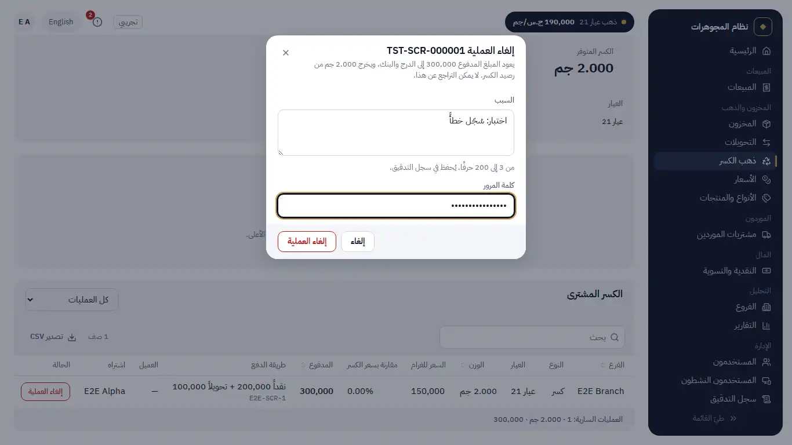
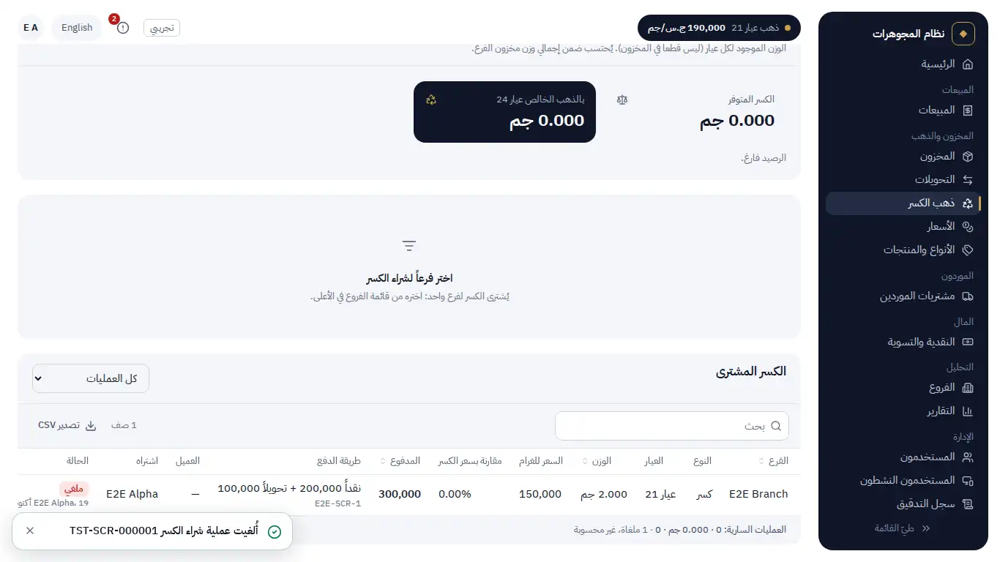
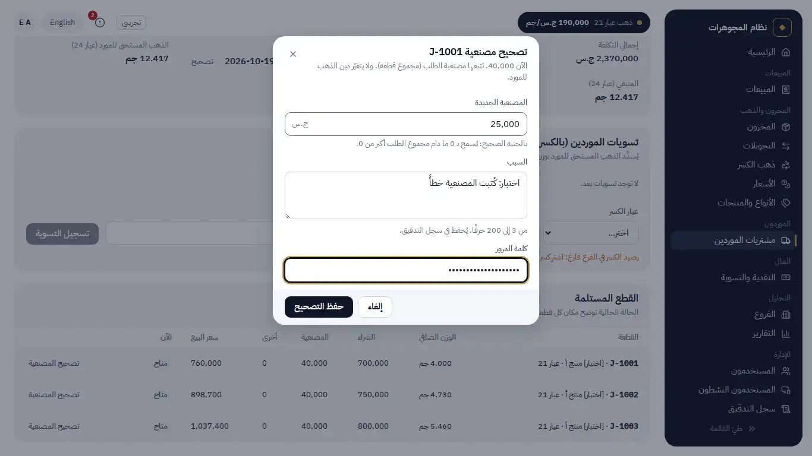
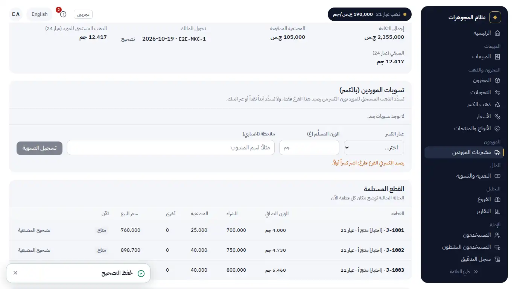

# Manual acceptance: MIS-1 (correcting mistakes: void a scrap purchase, correct a supplier order)

For the owner, about 15 minutes, in a desktop browser (Codespace or local). Engineering ran section A.

What changed:

- **Void a scrap purchase** (Scrap gold › "Scrap bought", General Manager only). You write a reason and enter your
  password. Then:
  - the money paid comes back: the cash part to the drawer, the bank part to the bank (dated today);
  - the purchase stays on its own day in the cash reconciliation, and the money back shows on the day of the void;
  - a **sellable piece** leaves stock (status VOIDED). This works only while the piece is still available in the
    branch that bought it. If it is sold or in transit, the void is refused and the piece is named;
  - **broken scrap** leaves the pool. This works only if the pool still holds that weight; otherwise the void is
    refused with the balance;
  - the list shows **VOIDED** with who, when and why; a filter shows all, valid only or voided only;
  - the totals under the list count valid purchases only and say how many voided ones were left out;
  - a purchase cannot be voided twice, and there is no limit on how old it may be.
- **Correct a supplier order** (Purchases › an order, General Manager only, reason and password):
  - **one piece's making cost** at a time. The order's making charge is the sum of its pieces. A sold piece cannot
    be corrected, and its sale keeps its cost exactly. A sale after the correction uses the new cost;
  - **the transfer reference**. A reference already on another order asks "Record anyway?";
  - the order shows every correction (what, from → to, why, who, when). The original is never overwritten, and the
    **supplier's gold debt never changes**;
  - the order's making charge cannot become 0 while it has a transfer reference (your answer Q5). One piece may go
    to 0.
- Branch managers and cashiers cannot do either. The branch manager sees the history (who, when, why) without the
  amounts.

Plan: `docs/plans/MIS-1.md` (your answers of 2026-10-19 in §6). Migration **0025** adds two history tables and the
VOIDED status (your approval Q2). Decisions D-mis1-1 to D-mis1-8.

Not built (as agreed): a scrap receipt or reprint; correcting an order's gold weight or pieces; voiding a supplier
order or a sale; undoing a void.

## A. What engineering ran (all green on the last commit)

| Gate | Result |
|---|---|
| `npm run verify -- --full` (Node 20) | see the report: summary pasted there |
| New tests (both projects) | `mis1-scrap-void`, `mis1-purchase-fix`, `purchase-fix.property` (fast-check: the order's charge = the sum of its pieces, sold pieces untouched, gold debt unchanged, stock value moves by new − old); upgrade test from 0024 with data |
| Real PostgreSQL only | `pg/scrap-void-race` (a sale and a void of the same piece at once: exactly one wins; two voids at once: one passes), `pg/purchase-fix-race` (a correction and a sale at once: one order of events, the sale line agrees) |
| Browser | `e2e-corrections` (19 checks, both dialogs), REH-1 (void broken and sellable scrap, a void after the sale refused, an order's making cost and reference corrected, the reconciliation and the supplier's gold owed checked) |

## B. Walk-through

Sign in as the General Manager.

### 1. Void a scrap purchase

1. Scrap gold: buy **broken scrap**, 2 g, paid part cash and part bank transfer.
2. In "Scrap bought", the row has a red **Void purchase** button. Click it.
   - Save stays grey until you write at least 3 characters and enter your password.
   - Try a wrong password: nothing is voided and the dialog says why.
   - Then enter the right password. 
3. The row now shows **VOIDED**, with your name, the time and the reason.
   - The line under the list counts only valid purchases and says "1 voided, not counted".
   - The filter shows "Voided only" or "Valid only". 
4. Scrap pool: the 2 g are gone.
5. Cash & reconciliation: today's "Scrap purchases" lines show the purchase and, against it, the money back. The
   drawer and the bank have their parts back.
6. Buy a **sellable piece**, sell it at the POS, then try to void its purchase. The dialog refuses it and names the
   piece (it is sold).
7. Branch manager: the Scrap list has no Void button.

### 2. Correct a supplier order

1. Purchases: open an order with a making charge.
   - Each unsold piece has **Correct making**.
   - Enter the new amount, a reason and your password, then save. 
2. The piece's making cost changes, and the order's "Making charge paid" and "Total cost" follow.
   - "Gold owed to the supplier" does not change.
   - "Corrections" lists it with from → to, the reason, you and the time. 
3. "Owner's transfer" › **Correct**: type the reference of another order.
   - It asks "Record anyway?". Confirm: saved.
   - The history notes "used on another order (confirmed)".
4. Try to set the last piece's making cost to 0 while the order keeps a reference. It is refused with the reason.
5. A sold piece has no **Correct making** button (the server refuses it too).
6. Audit log, filter "PURCHASE_CORRECTED" / "SCRAP_PURCHASE_VOIDED": each line has the reason and never the password.

## C. Questions for you

1. **There is no scrap CSV or scrap report today**, only the Scrap list. The void details and the "valid only" totals
   are on that list. Do you want a scrap report (with its CSV)? It would be a new item.
2. The two corrections also use the usual 5-minute password window. When it has expired, the app asks for your
   password before the dialog's own check, so you may type it twice, as for a large gold-rate change (DEC-1). Keep
   it, or let the dialog's password be enough?

## D. Still open with the client

Q-1 (making charge), Q-5 (clean scrap at another karat), Q-11 (hosting, sign-in hardware, backups), Q-13 (written
agreement), and whether the General Manager's funding is a loan or capital (CSH-2).
