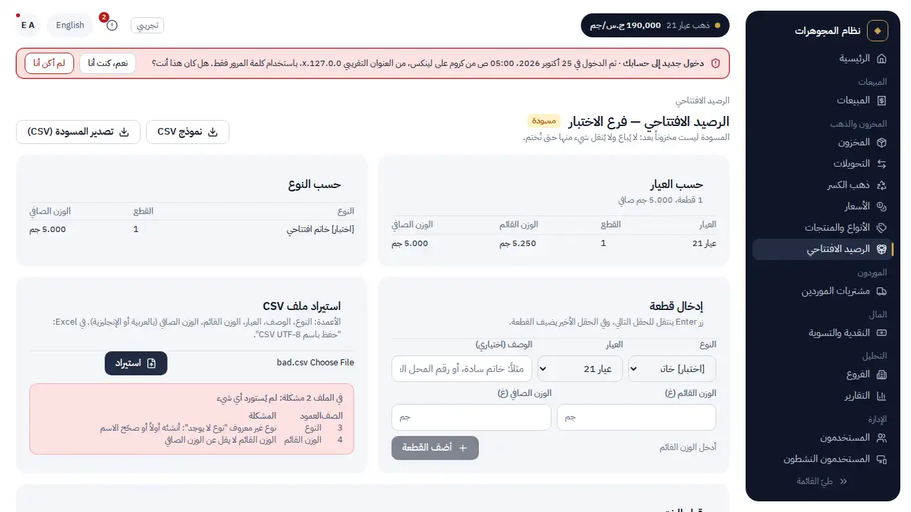
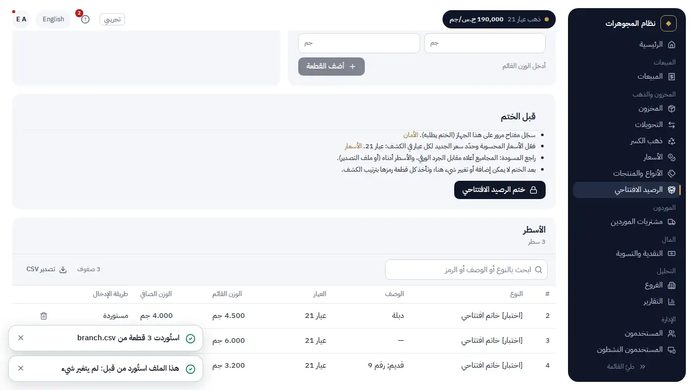
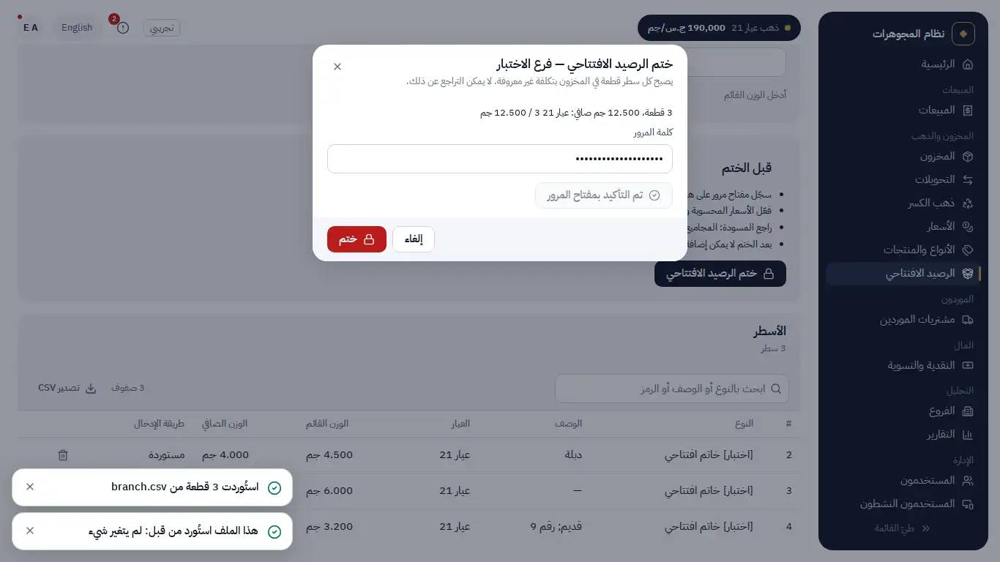
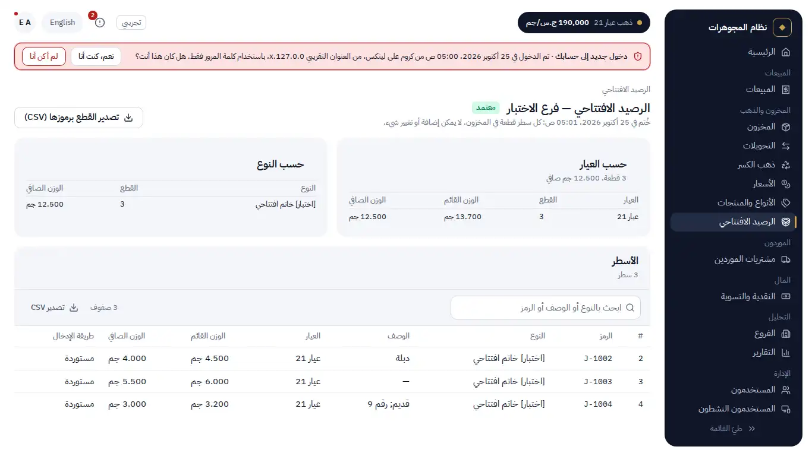

# Manual acceptance: OPN-1 with CAT-1 (opening balance; stock without a product catalog)

For the owner, about 20 minutes, in a desktop browser (Codespace or local). Engineering ran section A.

What changed:

- **A piece is a type + a description + a karat + weights** (CAT-1, your answer D-dec1-2). The product is optional
  everywhere stock comes in: the supplier order line, the sellable scrap purchase and the opening balance. Existing
  products still work: choosing one fixes the type and the karat. The description is free text (up to 120 characters,
  searchable); the form suggests the descriptions already used for the type. An old shop number goes there.
- **Renaming a type** (Types & products › Types › Rename, General Manager). Past sales and printed invoices keep the
  name they were sold under; the stock and new sales show the new one.
- **The opening balance** (menu "Opening balance", General Manager only), one per branch:
  - **Start** creates the branch's draft. A draft is not stock: nothing in it can be sold or moved.
  - **Type a piece**: type, karat, description, weights. Enter moves to the next field; the last Enter adds the piece.
  - **Import a CSV file** (Excel: "Save as CSV UTF-8"). Download the **CSV template** first (the header row, in Arabic
    and English). Comma or semicolon, Arabic or English column names, Arabic-Indic digits all work. **One wrong row
    rejects the whole file**: the page lists every problem with its row and column and imports nothing. The same file
    twice changes nothing. The type names in the file must exist already (nothing is invented).
  - **Review**: count and weight by karat and by type; the lines, paged and searchable; **Export the draft (CSV)**.
  - **Seal**: the checklist first (register a passkey, computed prices on and the new-piece rate of every karat set,
    review the draft). Sealing asks your **password and your passkey**. Every line becomes a piece with the next system
    code (J-…) in the order of the sheet, origin "Opening balance", **cost unknown** (never 0), price from the
    new-piece rate. No cash moves. After the seal nothing can be added or changed; the export then lists the codes to
    write on the tags.
- **Unknown cost, everywhere**: a sale of an opening piece shows its profit as "—" and is left out of every profit
  total; each total says how many lines it left out ("n line(s) of unknown cost not counted"). The stock value at cost
  leaves those pieces out and says how many. The weight and the value at today's rate count them as usual.

Plan: `docs/plans/OPN-1.md` (your answers of 2026-10-24 in §9). Migrations **0026** (additive), **0027** (fills the
type of every piece and the names on every sale line) and **0028** (the type becomes required; only an opening piece
may have an unknown cost). Decisions D-opn1-1 to D-opn1-7.

Not built (as agreed): correcting a sealed opening (OPN-FIX, BACKLOG P1, before real operation); XLSX import; labels
(LBL-1); a new/used condition column; product rename.

## A. What engineering ran (all green on the last commit)

| Gate | Result |
|---|---|
| `npm run verify -- --full` (Node 20) | see the report: summary pasted there |
| New tests (both projects) | `cat1-optional-product` (stock without a product, suggestions, rename keeps old sale names), `opn1-unknown-cost` (every profit and stock-value figure against Σ sale-line profit; transfer, damage, restock, return, sale void with a NULL cost; the ledger reconciles on known pieces), `opn1-openings` (one per branch, keyboard lines, good/bad/duplicate files, 300 rows over HTTP with a replayed key, limits, template, review, export, sealing refusals and success, the triggers), `csv.property`; upgrade test from 0015, 0019, 0023, 0024 and 0025 with data |
| Static guard | `check:item-joins` (in `npm run typecheck`): no inner join of pieces to products; the type comes through the piece |
| Browser | `e2e-openings` (26 checks), REH-1 on an empty production database (two types, a CSV import, the seal with password and a virtual passkey, the stock-weight report grows by the sheet's net weight, a sale of an opening piece, the profit report counts the excluded line) |
| Perf | a 5,000-row import and seal, then every list and home timed with those 5,000 pieces in stock: all within budget |

## B. Walk-through

Sign in as the General Manager.

### 0. Before the opening

1. **Security**: register a passkey on this computer (sealing needs it).
2. **Prices**: computed prices on, and a **new-piece rate** for every karat of your sheet.
3. **Types & products › New type**: create the types your sheet uses (for example rings, bangles), in your words.

### 1. Types and description

1. **Supplier purchases › New purchase**: leave **Product (optional)** empty; under the line choose the type, the karat
   and type a description. The description field suggests the ones used before for that type.
2. Save: the piece is in stock, named by its description (or by its type when there is none).
3. **Types & products › Types**: **Rename** a type that has a past sale. Open that sale: it still shows the old name;
   the stock shows the new one.

### 2. The opening balance of one branch

1. **Opening balance › Start** for the branch.
2. Type one piece with the keyboard only (Enter, Enter, …): the line appears under **Lines**.
3. Download the **CSV template**, fill three rows in Excel, add one row with a type that does not exist, "Save as CSV
   UTF-8" and **Import**: the page lists the problem with its row; nothing is imported. 
4. Correct the row and import again: the rows appear. Import the same file again: "already imported, nothing changed".
5. Remove the typed line (bin icon). Compare **By karat** with your paper count. **Export the draft (CSV)**.
   
6. **Seal the opening balance**: read the summary, enter your password, **Confirm with your passkey**, then **Seal**.
   
7. The page says **SEALED**; each line has its code (J-…); **Export the pieces with their codes (CSV)**.
   
8. **Inventory**, origin "Opening balance": the pieces are there. Open one: "Cost: unknown (opening balance)".
9. **POS**: sell one opening piece. Open the sale: profit "—" and "1 line(s) of unknown cost not counted". **Reports ›
   Profit**: the column "Lines of unknown cost" counts it.
10. Try to add a line to the sealed opening: there is no form any more (the server refuses it too).

## C. Questions for you

1. **Does the existing stock include used pieces?** Today every opening piece sells at the **new-piece** rate (your
   answer Q5). If some are used, we would add a condition column to the sheet (a new item).
2. **OPN-FIX** (correcting a piece of a sealed opening) is in the BACKLOG as P1 before real operation. Shall it be the
   next item?

## D. Still open with the client

Q-1 (making charge), Q-5 (clean scrap at another karat), Q-11 (hosting, sign-in hardware, backups), Q-13 (written
agreement), whether the General Manager's funding is a loan or capital (CSH-2), and the used-pieces question above.
